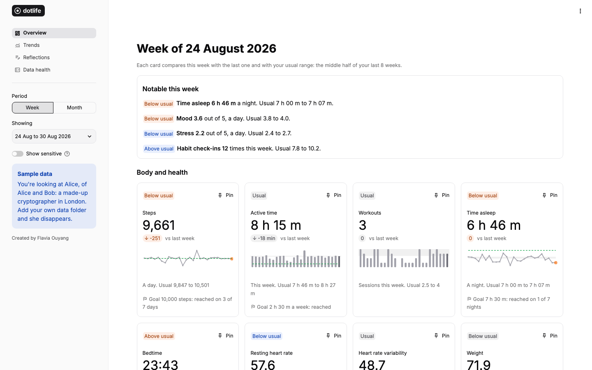
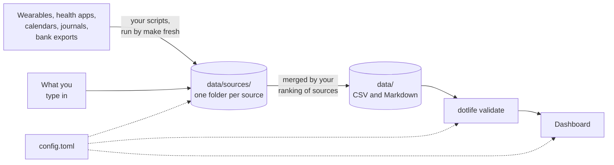

<div align="center">

<picture>
  <source media="(prefers-color-scheme: dark)" srcset="dotlife/dashboard/assets/wordmark-dark.svg">
  
</picture>

**A small, open-source life dashboard built on plain files you own.**

[](https://github.com/flaviaouyang/dotlife/actions/workflows/ci.yml)
[](https://github.com/flaviaouyang/dotlife/actions/workflows/release.yml)
[](https://github.com/flaviaouyang/dotlife/releases)
[](pyproject.toml)
[](LICENSE)

[The idea](#the-idea) · [How it works](#how-it-works) · [What you can track](#what-you-can-track) · [Where data comes from](#where-data-comes-from) · [Principles](#principles) · [Quick start](#quick-start) · [Contributing](#contributing)

</div>

> [!NOTE]
> **Alpha.** Everything described here works, but so far it has been tried on made-up data, not yet on many people's real exports. Expect rough edges and changes between releases; [CHANGELOG.md](CHANGELOG.md) lists what changed.

<picture>
  <source media="(prefers-color-scheme: dark)" srcset="docs/screenshots/overview-dark.png">
  
</picture>

## The idea

Health apps, wearables, calendars, journals and banks each keep your data in their own place. dotlife defines **one simple file format** for all of it: CSV and Markdown files in your own repo. Everything else is built on that format.

| | |
| --- | --- |
| **Format** | One file per kind of data, local dates, units in column names, and a `source` column that says where each value came from. It is the core of the project: see [FORMAT.md](FORMAT.md). |
| **Validator** | `dotlife validate` checks the files before anything reads them: columns, units, ranges, duplicates. It reports gaps and never fills them in. Python standard library only. |
| **Dashboard** | A Streamlit app that reads only the format. Every card and page hides itself when its data is missing: with only steps and sleep, you still get a working dashboard. |
| **Sample** | Made up and generated by a script, so the dashboard runs before you connect anything. |
| **Guides** | One guide per source in [docs/sources/](docs/sources/README.md): how to get the data out, how it maps to the format, and the choices it leaves to you. People follow them, and so do the skills. |
| **Set Up** | Your coding agent's `setup` skill works out what you track and where it comes from, checks its plan with you, and writes a script for each source, following the guides. Without an agent, `make setup` asks the questions and the guides take you through the rest. After that, `make fresh` updates your data with no AI involved, the `fetch` skill does the few steps that need an agent, and the `maintain` skill helps when something breaks or changes. |

There is no plug-in to write for each data source, and you don't need an AI assistant: everything the skills do is also written up as step-by-step guides for people.

## How it works



Each source keeps its own rows, so adding a second one, or swapping a watch for a ring, never rewrites the first. `make fresh` runs your scripts, then builds each data file from them: for each day, the source you ranked highest wins, and a lower one fills the days it missed. Sleep and workouts go by time instead, so a nap only one device caught is kept.

## What you can track

Every category is optional. It shows up when its file exists, and `enabled = false` in `config.toml` switches it off everywhere, including `make fresh`. Sensitive categories (marked *) stay hidden in the dashboard until you choose to show them.

| Area | Categories |
| --- | --- |
| Body and health | activity, workouts, sleep, heart, body, fitness markers, vitals, nutrition, mindfulness, menstrual cycle\*, medication\*, symptoms\*, blood glucose\* |
| Mind | mood, reflections\* |
| Time and work | time use, screen time, tasks |
| Habits and leisure | habits, reading, learning, media |
| Money | finances\* |
| Context | life events, weather, social\*, travel\* |

Anything else that is one number per day can be added as a custom metric in `config.toml`, with no code.

## Where data comes from

Each source has a guide in [docs/sources/](docs/sources/README.md), checked against the source's own documentation:

| Source | Fills |
| --- | --- |
| [Apple Health](docs/sources/apple-health.md) | activity, workouts, sleep, heart, body, fitness markers, vitals, nutrition, mindfulness, cycle, symptoms, glucose |
| [Google Health](docs/sources/google-health.md) (formerly Fitbit), [Oura](docs/sources/oura.md), [WHOOP](docs/sources/whoop.md) | activity, workouts, sleep, heart and more |
| [Apple Calendar](docs/sources/apple-calendar.md), [Google Calendar](docs/sources/google-calendar.md), [Outlook](docs/sources/outlook-calendar.md) | time use; optionally events, social, travel |
| [jrnl](docs/sources/jrnl.md), [Obsidian daily notes](docs/sources/obsidian-daily-notes.md) | reflections; from Obsidian also mood, habits, tasks |
| [Open-Meteo](docs/sources/weather.md) | weather, with no account |
| [By hand](docs/sources/manual.md) | anything |
| [Inference](docs/sources/inference.md) | a metric your other data answers, if you opt in: dining out from transactions, or mood read from reflections by your agent |

[sources.example.md](sources.example.md) shows a finished setup for the sample's Alice.

## Principles

- **Your files, your repo.** Plain text you can open, edit, diff and delete.
- **Scripts over AI.** A script gives the same answer every time. AI is used only where a script can't do the job: a source only a connector reaches, or reading text you chose to have read.
- **Missing data stays missing.** Nothing is estimated or invented. Gaps are reported, not filled.
- **One settings file.** Every threshold and personal choice lives in `config.toml`.
- **Private by default.** Your data stays in your repo. The dashboard only listens on your own computer and sends Streamlit no usage statistics. An AI model sees your data only for a step you chose, such as inferring mood from reflections, and `sources.md` records each one.
- **Small.** A codebase you can read in an afternoon.

<details>
<summary>Rules the format builds in</summary>

- Weeks run Monday to Sunday and months are calendar months, in your local time zone, with daylight saving time handled.
- A night's sleep counts toward the day you woke up. Bedtimes are averaged as minutes after 18:00, so times past midnight work.
- When two sources report the same category, the one you rank higher wins each day it has data. Rank a smart scale first, and its weight wins on any day it has a reading. Sleep and workouts are matched by time, so the same night recorded twice comes from the better source.
- A day with very few steps and little sedentary time means the watch wasn't worn, and so does a day only a fallback device (a phone without the watch) recorded. Such days stay in the files but are left out of daily averages and counted separately.
- An inferred value is labelled with what it came from, never replaces a recorded one, and stays empty without evidence. The dashboard says how many days were inferred.
- A value that stops changing, like VO2 max on a watch that only updates it after outdoor runs, is marked stale instead of being trusted.
- Impossible values (more than 1440 minutes in a day) are errors. Unlikely ones (60,000 steps, a date after today) are warnings, and you can adjust the bounds.

</details>

## Quick start

```sh
make install     # or: uv sync
make validate    # or: uv run dotlife validate
make dashboard   # or: uv run dotlife dashboard
```

Until you add your own `data/` folder, both read the sample data: half a year in the life of Alice, the Alice of Alice and Bob, as a cryptographer in London in 2026. It covers every category, with a few gaps and odd values planted so every rule shows up. Every value is made up. Setting up your own sources removes it.

To use your own data, create a private repo from this template, then:

- **With an AI coding agent:** open it in the repo and run the `setup` skill (`/setup` in Claude Code). It proposes a plan from what it knows, checks it with you, and writes your scripts.
- **Without one:** run `make setup` to answer a few questions, then follow the guides in `docs/sources/`.

Either way, `make fresh` brings in new data from then on, with no AI involved. If you use inference or a source only an agent can reach, ask your agent to fetch (the `fetch` skill), and when something breaks or changes, to maintain (the `maintain` skill).

## Contributing

See [CONTRIBUTING.md](CONTRIBUTING.md). The most useful contributions are guides for new data sources (Garmin, Withings, Strava, a bank), and fixes to existing guides when a source changes. Never include your own data in an issue or pull request.

## License

[MIT](LICENSE)

---

Created by [Flavia Ouyang](https://www.flaviaouyang.com).
