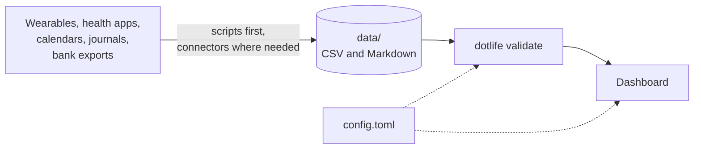

<div align="center">

<picture>
  <source media="(prefers-color-scheme: dark)" srcset="dotlife/dashboard/assets/wordmark-dark.svg">
  
</picture>

**A small, open-source life dashboard built on plain files you own.**

[](https://github.com/flaviaouyang/dotlife/actions/workflows/ci.yml)
[](https://github.com/flaviaouyang/dotlife/actions/workflows/release.yml)
[](https://github.com/flaviaouyang/dotlife/releases)
[](pyproject.toml)
[](LICENSE)

[The idea](#the-idea) · [How it works](#how-it-works) · [What you can track](#what-you-can-track) · [Principles](#principles) · [Quick start](#quick-start) · [Contributing](#contributing)

</div>

> [!NOTE]
> **Early work in progress.** dotlife is in alpha, and most of what's described here isn't built yet. [CHANGELOG.md](CHANGELOG.md) lists what's done so far.

## The idea

Health apps, wearables, calendars, journals and banks each keep your data in their own place. dotlife defines **one simple file format** for all of it: CSV and Markdown files in your own repo. Everything else is built on that format.

| | |
| --- | --- |
| **The format** | One file per kind of data, local dates, units in column names, and a `source` column that says where each value came from. It is the core of the project: see [FORMAT.md](FORMAT.md). |
| **A validator** | `dotlife validate` checks the files before anything reads them: columns, units, ranges, duplicates. It reports gaps and never fills them in. Python standard library only. |
| **A dashboard** | A Streamlit app that reads only the format. Every card and page hides itself when its data is missing: with only steps and sleep, you still get a working dashboard. |
| **Sample data** | Made up and generated by a script, so the dashboard runs before you connect anything. |
| **Agent skills** | `setup-sources` finds your connectors and exports, asks a few questions and writes `sources.md`, with a script for every source that can be scripted. `sync` follows it, updates your files and runs the validator. |

There is no plug-in to write for each data source, and you don't need an AI assistant: everything the skills do is also written up as step-by-step guides for people.

## How it works



## What you can track

Every category is optional. It shows up when its file exists, and `enabled = false` in `config.toml` switches it off everywhere, including sync. Sensitive categories (marked *) stay hidden in the dashboard until you choose to show them.

| Area | Categories |
| --- | --- |
| Body and health | activity, workouts, sleep, heart, body, fitness markers, vitals, nutrition, mindfulness, menstrual cycle\*, medication\*, symptoms\*, blood glucose\* |
| Mind | mood, reflections\* |
| Time and work | time use, screen time, tasks |
| Habits and leisure | habits, reading, learning, media |
| Money | finances\* |
| Context | life events, weather, social\*, travel\* |

Anything else that is one number per day can be added as a custom metric in `config.toml`, with no code.

## Principles

- **Your files, your repo.** Plain text you can open, edit, diff and delete.
- **Scripts over AI.** A script gives the same answer every time. AI is used only where a source can't be reached any other way.
- **Missing data stays missing.** Nothing is estimated or invented. Gaps are reported, not filled.
- **One settings file.** Every threshold and personal choice lives in `config.toml`.
- **Small.** A codebase you can read in an afternoon.

<details>
<summary>Rules the format builds in</summary>

- Weeks run Monday to Sunday and months are calendar months, in your local time zone, with daylight saving time handled.
- A night's sleep counts toward the day you woke up. Bedtimes are averaged as minutes after 18:00, so times past midnight work.
- When two sources report the same metric, one wins by a priority you set. Weight is the exception: a smart-scale reading wins on any day it has one.
- A day with very few steps and little sedentary time means the watch wasn't worn. It is left out of daily averages and counted separately.
- A value that stops changing, like VO2 max on a watch that only updates it after outdoor runs, is marked stale instead of being trusted.
- Impossible values (more than 1440 minutes in a day) are errors. Unlikely ones (60,000 steps) are warnings, with bounds you can adjust.

</details>

## Quick start

```sh
make install     # or: uv sync
make validate    # or: uv run dotlife validate
make dashboard   # or: uv run dotlife dashboard
```

Until you add your own `data/` folder, both read the sample data: half a year in the life of Alice, the Alice of Alice and Bob, as a cryptographer in London in 2026. It covers every category, with a few gaps and odd values planted so every rule shows up. Every value is made up. Setting up your own sources removes it.

To use your own data, create a private repo from this template. Then follow the guides in `docs/sources/`, or let your coding agent run the `setup-sources` skill.

## Contributing

See [CONTRIBUTING.md](CONTRIBUTING.md). Once the format is stable, the most useful contributions will be guides for new data sources.

## License

[MIT](LICENSE)
